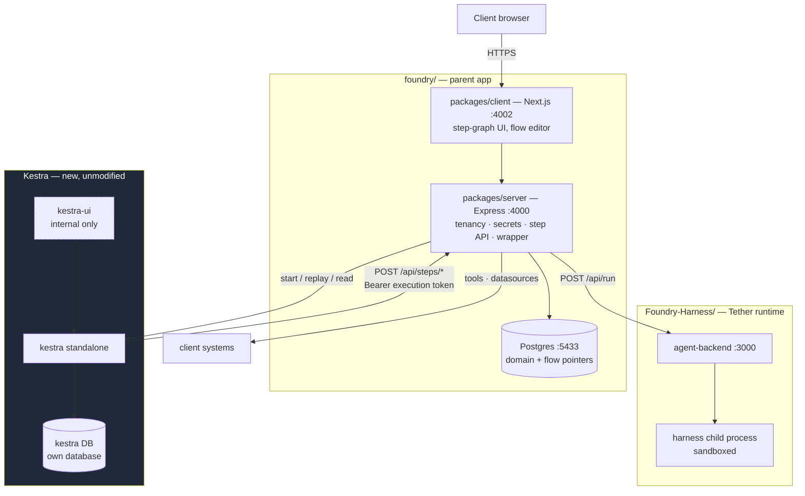

## 4. Target architecture



**Dependency direction points out of Foundry.** Kestra is a dependency Foundry calls, the same way
it calls Postgres. It does not sit in front of Foundry, and clients never reach it.

### Deployment delta

`foundry/infra/docker-compose.yml` gains **one** service and **one** database on the existing
Postgres instance:

| Service | Status |
| :--- | :--- |
| `postgres` :5433 | existing — add a `kestra` database |
| `redis` :6380 | existing, unchanged |
| `kestra` | **new** — standalone, JVM |
| `foundry-server` :4000 / `foundry-client` :4002 / `mcp-bridge` :3015 | existing |

Tether's own `docker-compose.yml` is untouched.

### Connectivity — how the three services actually reach each other

**Kestra never connects to Tether.** It has no client for it, no credential for it, and must have no
network route to it.

Kestra's entire outbound capability is one generic task type:

```yaml
type: io.kestra.plugin.core.http.Request
```

That is the whole "way of calling a backend" — no SDK, no plugin, no connector. Which is exactly why
R2 is enforceable: if the only emitted task type is an HTTP request at Foundry, Kestra can't reach
anything else.

Why not point it at Tether directly:

| | |
| :--- | :--- |
| **Credential** | Tether needs a tenant-scoped `x-api-key` (`tth_live_…`). Kestra OSS has no tenant-scoped secret store, so it would hold one key with access to every tenant. |
| **Correlation state** | The agent step must write `flow_step_runs`, join the run contract, and record the audit verdict. Kestra can't write to Foundry's database. |
| **Tenant mapping** | Which profile / template / session a step uses is `tenant-mapper.service.ts` + `tether-client.service.ts` logic. |

#### Two authenticated channels, opposite directions

| Direction | Purpose | Auth |
| :--- | :--- | :--- |
| **Kestra → Foundry** | step execution (`POST /api/steps/*`) | Bearer **execution-scoped token** (R3) |
| **Foundry → Kestra** | start execution, resume, replay, read state, deploy flow | Kestra API credential (Foundry-held) |
| **Foundry → Tether** | `POST /api/run`, poll `GET /api/run/:id` | `x-api-key` (Foundry-held) |

Both Kestra-facing directions are needed. Neither implies the other: Kestra can call Foundry without
knowing how to start anything, and Foundry drives all lifecycle transitions.

#### Network-level enforcement — defence in depth for R8

R8 is a compiler invariant. Back it with network policy so a compiler bug or an unforeseen task type
still can't reach out:

| From → To | Policy |
| :--- | :--- |
| Kestra → Foundry `:4000` | **allow** — the only egress it needs |
| Kestra → Kestra's own database | allow |
| Kestra → **Tether** | **deny** |
| Kestra → internet / cloud metadata (`169.254.169.254`) | **deny** |
| Kestra → Foundry's Postgres, Redis | **deny** |
| Client browser → Kestra / `kestra-ui` | **deny** (R5) |
| Foundry → Kestra | allow |

An egress allowlist of exactly one host is what turns R8 from a code-review discipline into an
enforced boundary.

---

## 5. Concept mapping

### 5.0 Vocabulary and hierarchy — read this first

**tenant ⊃ workspace ⊃ users.**

| Term | Means | Owns | Example |
| :--- | :--- | :--- | :--- |
| **Tenant** | The client. **The hard security boundary.** | Workspaces, the commercial contract | `acme` |
| **Workspace** | A domain within a tenant | Tools, datasources, manifest, **secrets**, schema, **flows** | `HR` — 14 tools, 7 tables |
| **User** | A person in a workspace, possibly grouped | Authorship; approval if admin | `attendance_team` members |
| **Tether tenant** | The secret-injection boundary in the runtime | Mapped via `tenant-mapper.service.ts` | `tenantOf(req)` in `canAccess` |

**Flows belong to a workspace, not a user.** A flow references the workspace's tools and datasources,
so it cannot span workspaces — different manifest, different schema.

> One caveat that still bites: `workspace_secrets` is scoped to a **workspace**, while Tether injects
> connectors per **Tether tenant**. Those are different scopes, which is why
> `tenant-mapper.service.ts` exists. Keep the distinction explicit at that seam.

#### Namespace layout — grain is the workspace

```
acme                        ← tenant root — nothing executable
├── acme.hr                 ← workspace, LIVE (approved revisions only)
├── acme.hr.draft           ← working revisions
├── acme.finance
└── acme.finance.draft
```

The tenant prefix is **mandatory**: two clients will both have a workspace called `HR`, and namespace
collision across tenants would be a cross-tenant data leak.

**Use immutable slugs, not display names.** A slug is assigned at creation and never changes; a
renamed workspace must keep its namespace. Foundry stores the mapping. This keeps `kestra-ui` readable
for internal debugging while avoiding the mutable-name problem — UUIDs would be stable but make the
operator UI useless.

Users do **not** get their own namespaces. Isolation between users in a workspace is a *permissions*
concern (who may edit, who may approve), enforced in Foundry — not a namespace concern. They share the
workspace's credentials and data by design.

#### Consequences of the workspace being the credential boundary

| | |
| :--- | :--- |
| **Approval: separation of duties, not escalation** | The approver must be a **different human than the author**, and a workspace admin. Cleaner than escalating to tenant level, and it works at any grain. |
| **Budgets need two levels** | Per **workspace** (shares one credential, so shares its rate limit) and a per-**tenant** ceiling (the commercial contract is with the tenant) |
| **Intra-workspace sharing needs no regeneration** | Same manifest and schema, so fragments travel intact. Cross-workspace and cross-tenant sharing strips code (§5.2). |

| Foundry today | Kestra | Notes |
| :--- | :--- | :--- |
| `tenants` | namespace **root** (e.g. `acme`) | Nothing executable lives here |
| `workspaces` row | **two** namespaces — `<tenant>.<ws>` (live) + `<tenant>.<ws>.draft` | Namespace is **organisational, not a security boundary** — R4. Tenant prefix mandatory; immutable slugs. See §5.0 |
| `scripts` row (automation) | flow | `scripts` is **dropped** — see §7.0 |
| `script_versions` | flow revision | Kestra versions flows natively |
| `execution_results` | execution | **Dropped** — §7.0 |
| — | **taskrun** | **New concept. This is the entire point.** |
| `triggers` (**schedule**) | **Schedule trigger** | **Moves to Kestra** — deployed at approval, removed on revoke (§5.4) |
| `triggers` (webhook) | webhook trigger exists, **unused** | Stays in Foundry — Kestra webhooks would need client→Kestra access (R4, R5) |
| `triggers` (poll) | no equivalent | Stays in Foundry — changed-since-hash semantics don't map |
| `test_results` | — | Becomes per-step |
| `tools`, `datasources`, `workspace_manifests` | no equivalent | Stays in Foundry entirely |
| `workspace_secrets` | no safe equivalent | Stays in Foundry (R2) |
| `audit_verdict`, oracle score | no equivalent | Stays in Foundry, joined per step |

### How triggers split

| Trigger type | Owner | Why |
| :--- | :--- | :--- |
| **Schedule** | **Kestra** | Cron parsing, timezones, catch-up and overlap policy for free (§5.4) |
| Webhook | Foundry | A Kestra webhook would require client→Kestra access (R4, R5) |
| Poll | Foundry | Changed-since-last-hash has no Kestra equivalent |

`enableReadiness()` — *"a trigger may only arm when its automation has one succeeded execution"*, which
exists because *"a script with `tests_passed=true` + audit `clean` once emailed 0 of 11 people"* — does
**not** need expressing in Kestra. It gates **whether the Kestra trigger is deployed at all**, which is
stronger than a runtime check: an unapproved flow has no trigger and structurally cannot fire.

Consequence: Kestra initiates scheduled executions, so Foundry no longer mints the token up-front.
Every flow's first task is **`begin`** — Foundry validates approval freshness, manifest fingerprint and
budget, then returns the token (§5.4, §6.1).

### 5.4 Kestra capability inventory — what we take, what we can't

R2 says maximise Kestra. This table is the audit: every capability, whether we use it, and if not,
**why not**. "Because we already built it" is not a reason to keep something.

| Kestra capability | Use it? | Notes |
| :--- | :--- | :--- |
| Sequencing, DAG ordering | ✅ | |
| Per-step records (taskruns) | ✅ | Read via API — **not duplicated** into Foundry |
| Replay from task | ✅ | The capability we could not build well ourselves |
| `Pause` / resume, with native timeout | ✅ | Use its timeout, don't build one |
| Retries + backoff, per task | ✅ | Replaces nothing — we had none |
| `ForEach` fan-out, parallel branches | ✅ | |
| `If` / conditional branching | ✅ | |
| `Subflow` composition | ✅ | With a depth cap at validation |
| **Docker task runner for `code` steps** | ✅ | §R9 — Docker only, network off |
| `inputFiles` / `outputFiles` | ✅ | Replaces hand-rolled step data passing |
| `WorkingDirectory` (shared FS across script tasks) | ✅ | For multi-fragment flows |
| **Schedule triggers** | ✅ | **Changed** — see below. Replaces `trigger-scheduler.ts` cron |
| Flow revisions | ✅ | Kestra is SoR for deployed YAML |
| `POST /flows/validate` | ✅ | Machine gate before deploy |
| **Flow-level `concurrency` limit** | ✅ | ⚠ verify version. Complements M3 — per-flow, not per-tenant |
| Execution labels | ✅ | Carry workspace + flow revision for filtering |
| Flow-level SLA / max duration | ✅ | Don't build timeouts |
| Namespace KV store | ➖ | Non-secret per-workspace config. Low priority. |
| `kestra-ui` | ✅ **internal only** | R5 |
| JDBC / HTTP plugins calling client systems directly | ❌ | **Needs tenant credentials** (R2) |
| Kestra secret backend | ❌ | Env-var scoped, no tenancy (R2) |
| Webhook triggers | ❌ | Would require client→Kestra access (R4, R5) |
| Polling triggers | ❌ | Their changed-since-hash semantics don't map |
| Multi-tenancy, RBAC, SSO, audit logs | ❌ | EE — and Foundry already provides all four |
| Worker isolation | ❌ | EE. Container isolation still holds; resource sharing covered by M3 |

#### Change: schedule triggers move to Kestra

Reversing §5's earlier position again, now under R2. The objection was that `enableReadiness()` and
approval are Foundry concepts Kestra can't express. But they don't need to be *expressed* in Kestra —
they gate **whether the trigger exists there at all**:

> **The Kestra Schedule trigger is deployed as part of approval promotion, and removed when approval
> is revoked or goes stale.**

The gate becomes structural: an unapproved flow has no trigger in Kestra, so it cannot fire. That is
stronger than a runtime check, and it hands cron parsing, timezone handling, catch-up and overlap
policy to Kestra instead of `trigger-scheduler.ts`.

Consequence: Kestra now *initiates* scheduled executions, so Foundry no longer mints the token
up-front. Every flow's **first task is `begin`** — it calls Foundry, which validates approval
freshness and the tenant budget, and returns the execution token. A refused `begin` fails the
execution immediately at step 1.

Poll and webhook triggers stay in Foundry (custom hash semantics; no client access to Kestra).

