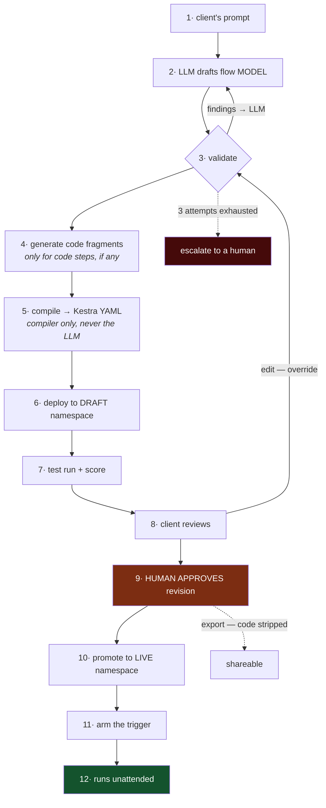
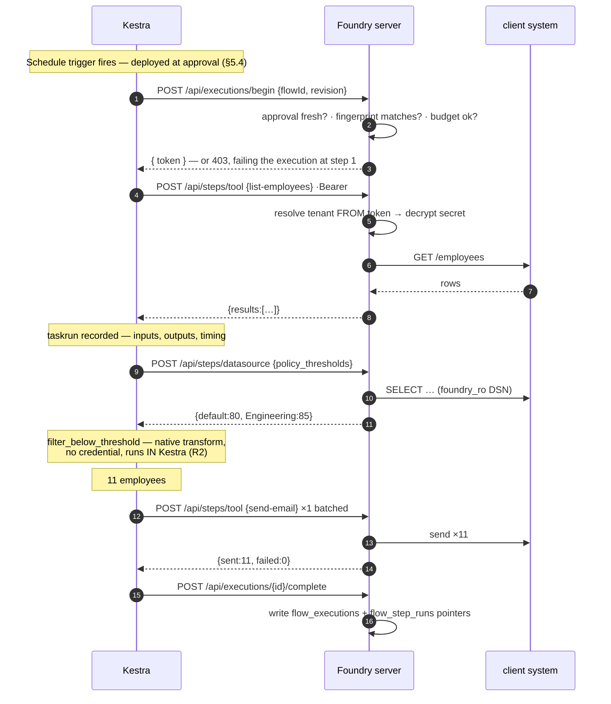
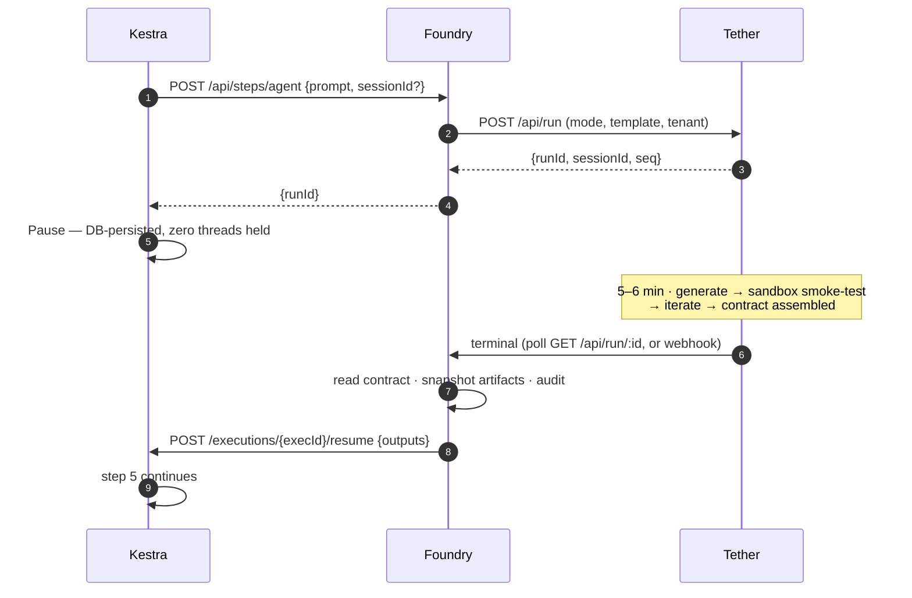
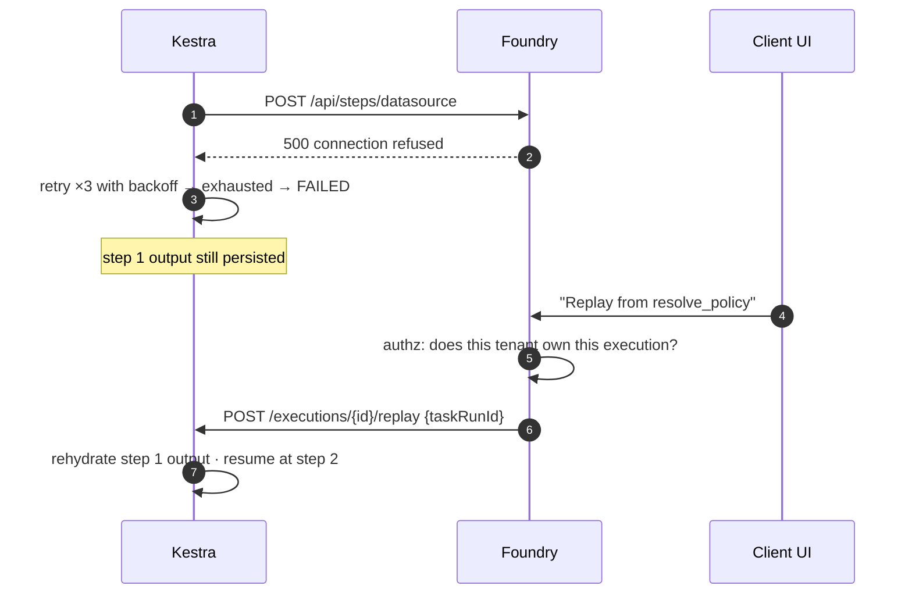
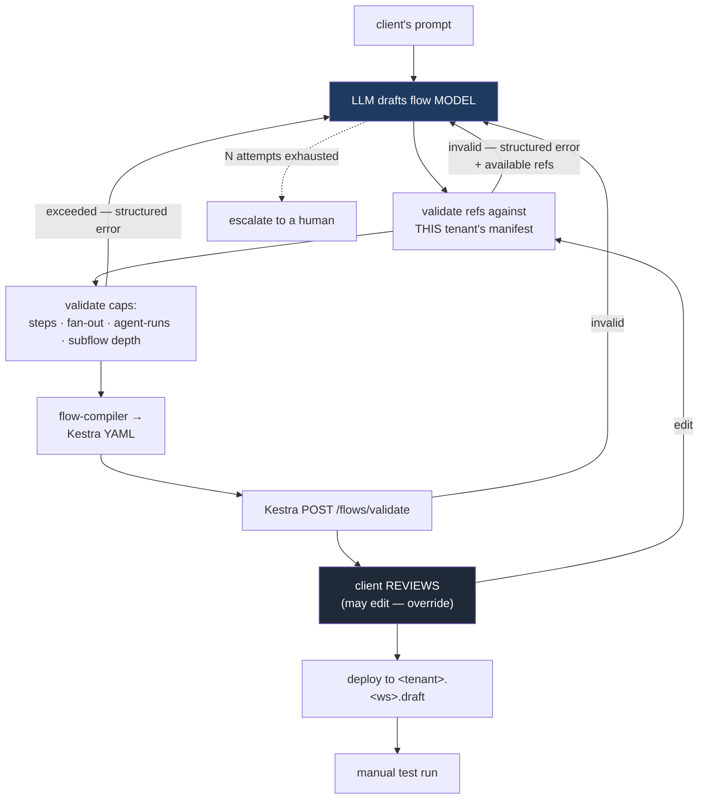
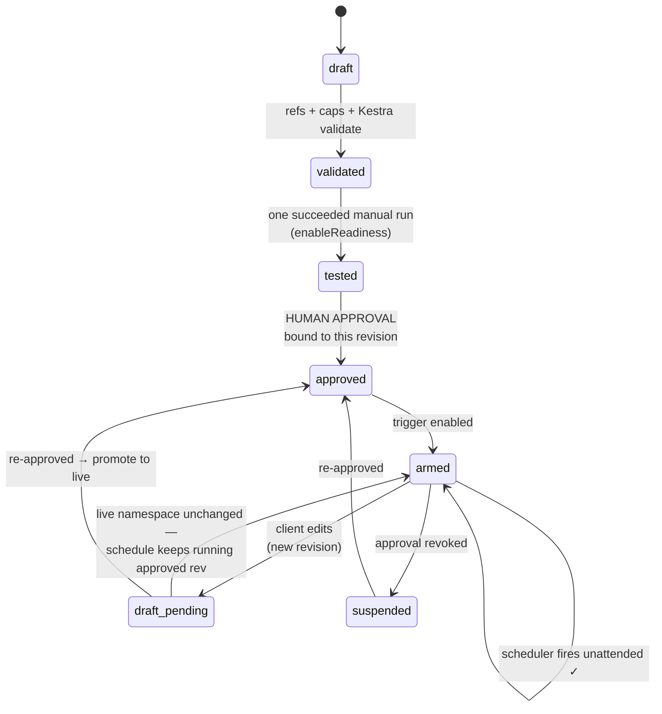

## 6. Request flows

### 6.0 Lifecycle at a glance

One sentence in, an unattended Monday-morning run out. Twelve stages, three gates.



| Stage | Who acts | Notes |
| :--- | :--- | :--- |
| 1 | Client | Intent. One sentence. Never code, never structure. |
| 2–4 | **LLM** | Drafts the model; generates fragments only where `code` steps exist |
| 3 | `flow-validator` | **Findings go to the LLM, not the user.** Bounded at 3 attempts (§6.4) |
| 5 | `flow-compiler` | Sole YAML emitter (R8) |
| 6–7 | Foundry + Kestra | Draft namespace only; scored against expected output |
| 8 | Client | **Review.** Editing is available as an override, not a requirement |
| **9** | **Human approver** | Binds to a *revision* (§6.5). Without this, nothing runs unattended |
| 10–11 | Foundry | Promote draft → live; arm |
| **12** | Scheduler | **The end goal.** Nothing regenerates on subsequent runs |

Three gates, none replacing another: `enableReadiness()` (stage 7 succeeded at least once) →
**schedule approval** (stage 9) → step approvals (per execution, mid-flow, optional).

Two things this diagram makes explicit that are easy to get wrong:

- **Stage 4 is conditional.** §14's worked example has zero `code` steps because the HR manifest
  covers its domain. Code generation is not a guaranteed stage.
- **"Shareable" is a side capability, not the terminus.** The chain ends at *running*. Export becomes
  available once a revision is approved, and it strips generated code (§5.2).

### 6.1 Scheduled execution — the common case



Note what this structurally prevents: `period` arrives as a **flow input**, so the hardcoded-date
failure cannot occur. The threshold comes from step 2, so the missing-`COALESCE` failure cannot
occur. Neither required better generation.

### 6.2 Agent step — hybrid flows



Pause/resume is what makes a 6-minute step free: no Kestra worker thread is held, and the paused
state survives a Kestra restart.

#### How Foundry learns the run finished — reuse `pollRun`

Tether has **no run-completion webhook**; the parent polls. Foundry already does exactly this:
`pollRun()` at `script-generation.service.ts:612` polls `GET /api/run/:id`, publishes onto
`generationBus`, and re-fetches once at the end to close the poll-gap race (`:725`).

**Reuse that pattern rather than inventing a new one** — and note it already solves the orphan
problem the agent step would otherwise reintroduce:

> *`:537-552` — "the generation poller runs in-process, so a server restart orphans it. On boot,
> re-attach a poller."*

So the agent step's poller must likewise re-attach on boot, keyed on `flow_step_runs` rows in
`awaiting_agent`. Without it, a Foundry restart leaves a Kestra execution paused forever.

#### Correlation

| Step | Record written | Lookup on completion |
| :--- | :--- | :--- |
| `POST /api/steps/agent` | `flow_step_runs` row: `kestra_execution_id`, `kestra_taskrun_id`, `step_id`, **`tether_run_id`** | — |
| Tether run terminal | — | `tether_run_id` → `kestra_execution_id` → resume |

`flow_step_runs.tether_run_id` needs a unique index; it is the only join key between the two systems.

#### HITL *inside* an agent step

If the agent calls `ask_questions` mid-run, Tether parks the question and flips the run to
`awaiting_input`. The Kestra execution is **already paused**, so no second mechanism is needed:

```
agent asks → Tether run = awaiting_input
           → Foundry's poller sees it → surfaces the question on the paused step in the UI
           → client answers → Foundry POST /api/run/:id/answer
           → agent continues → terminal → Foundry resumes Kestra
```

One caveat carried from Tether: `ASK_TIMEOUT_MS` bounds the wait at 10 minutes, and the parked
promise is in-process. A Tether restart during an unanswered question loses it — the flow step then
fails on the absolute backstop rather than hanging. Acceptable; worth knowing.

### 6.3 Failure and replay — the capability we don't have today



### 6.4 Authoring — clients author, edit, and change flows

**Decided:** clients author their own flows — but *authoring* means describing intent and approving
the result, not assembling steps by hand. **The LLM drafts; the validator corrects it; the client
reviews.** `FlowEditor` is a full builder and clients may edit freely, but editing is an **override,
not the default path**.

Because both LLM output and client edits are **untrusted**, R8 governs: neither emits YAML, and
`flow-compiler.service.ts` is the sole emitter.



#### The redraft loop is the primary correction mechanism

Every validator finding goes back to the **LLM**, not to the user. This is already a measured
property of this system: *"feeding the specific error back did fix it every time — continuation
prompts are ~800 chars against a cached prefix, so iterating is cheap."*

Two requirements follow, and they are load-bearing for `flow-validator.service.ts`:

1. **Errors must be LLM-consumable, not human prose.** A finding carries the offending step, the
   rule violated, and *the facts needed to fix it* — e.g. `unknown tool "list-approved-leave";
   available in this workspace: [...]`. A bare "invalid tool" wastes a redraft cycle.
2. **The loop is bounded.** Cap redraft attempts (start at 3). On exhaustion, escalate to a human
   with the accumulated findings rather than looping on tokens.

#### The validator has two jobs, and the first one is bigger

I initially framed `flow-validator` as a security control against malicious client input. It is
that, but its **primary** job is catching LLM error — in §14 both findings are LLM mistakes, not
client mistakes. The security case is the rarer one.

Generation is **design-time**, never on the request path. This is safe in a way it would not have
been under Airflow: Kestra flows are **YAML data** parsed at execution, so nothing is imported or
executed at parse time — and under R8 neither the LLM nor the client ever touches the YAML.

### 6.5 The schedule approval lifecycle

**Decided:** a schedule may run automatically **once approved.** Every *new* schedule requires at
least one human approval before it can fire unattended.

#### Why approval must bind to a revision

These two decisions interact dangerously. If approval attached to the *flow*, then a client who
edits an approved flow would silently repoint an already-armed schedule at different behaviour —
"approve once" becomes a permanent blank cheque over content that keeps changing. That is
privilege escalation by editing.

So: **approval binds to a specific revision.** Editing produces a new revision that is unapproved.

#### The two-namespace mechanism

| Namespace | Contains | Who triggers it |
| :--- | :--- | :--- |
| `<tenant>.<ws>` | the **approved** revision | the scheduler, unattended |
| `<tenant>.<ws>.draft` | the working revision | manual test runs only |

Approval is a **promotion**: compile the draft model, deploy it to the live namespace, record the
approval against that revision. Kestra's own revision history gives you rollback for free.

This design deliberately avoids depending on revision-pinned execution in Kestra's API. It also
means **editing never interrupts a running schedule** — the live namespace keeps serving the
approved revision while the draft evolves.



#### Gate composition

Three independent gates, in order. None replaces another:

| Gate | Question | Mechanism |
| :--- | :--- | :--- |
| 1. `enableReadiness()` | Has this revision ever succeeded? | existing, extended to flow executions |
| 2. **Schedule approval** | May this revision run *unattended*? | **new** — human, per revision |
| 3. Step approval | May *this execution* proceed past step N? | Kestra `Pause`, per execution |

Gate 2 is "may it run without a human watching." Gate 3 is "may this particular run continue." Do
not conflate them — a flow can be schedule-approved and still pause every execution for a
step-level approval.

#### Who approves

The client's own admin, scoped to their tenant. Blast radius is their own tenant, their own data,
their own credentials — so self-approval within a tenant is acceptable. Foundry enforces only that
the approver is a distinct authenticated human with the approver role, not the API key that created
the flow.

**Optional tightening, deferred:** require Foundry-operator approval when a flow contains
write-capable steps. `CLAUDE.md` already carries this instinct (*"write automations go behind a
human approval gate; nothing auto-executes"*). Decide when the first write-capable client flow
appears; the `flow_approvals.approver_kind` column leaves room for it.

#### What invalidates an approval

**Structure changes need a human; fragment changes need a re-test.** As originally written, every
fragment regeneration invalidated approval — and at 1-of-3 first-pass accuracy you regenerate
constantly, so every fix became an approval cycle. That friction gets the gate disabled.

| Change | Requires |
| :--- | :--- |
| **Structure** — steps added/removed, tools changed, contracts changed, side effects changed | **Human re-approval** |
| **Fragment body only**, contract unchanged | **Automated re-test.** Approval carries over. |

This is safe *because of R9*: a pure fragment has no side effects, so what the approver signed off on
— which systems get touched — is unchanged. Values still need checking, which is what the mandatory
test run is for.

| Event | Effect |
| :--- | :--- |
| Flow steps edited | New revision, unapproved. Live namespace unaffected. |
| Fragment regenerated, contract unchanged | New revision; approval **carries over** pending a passing test run |
| A referenced tool/datasource changes shape | Approval **stale** → schedule suspends, re-approval required |
| A referenced secret is rotated | No effect — bound by env-var name, not value |
| Manifest version bump with no ref change | No effect |
| Approver's role revoked | Existing approvals stand; they were valid when made |

The tool-shape case matters: a client approved a flow against a tool with three parameters. If that
tool gains a required fourth, the approved flow is now wrong. Compare `manifest_refs_json` against
the current manifest on every scheduler tick and suspend on divergence.

---

