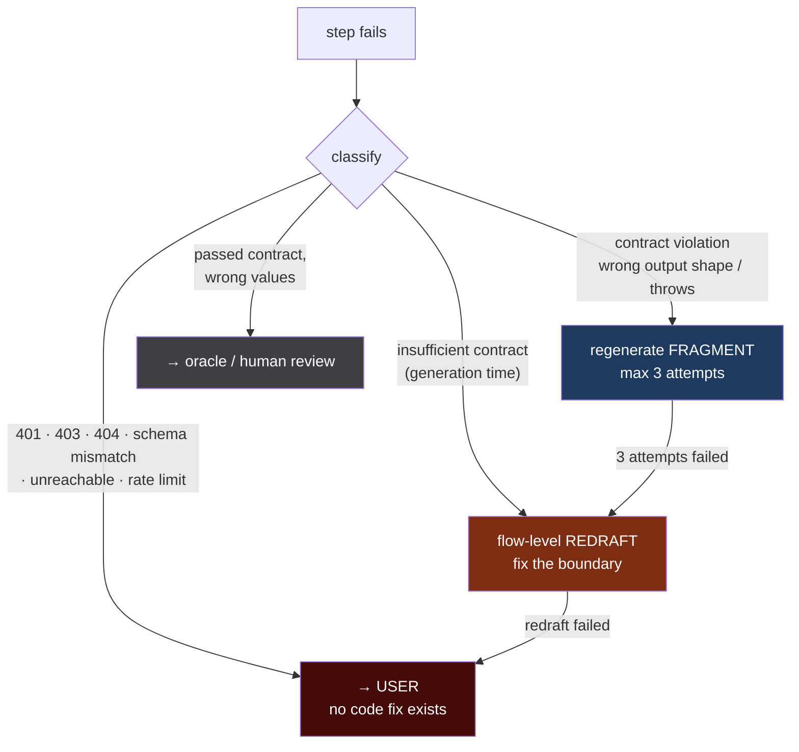

## 6 *(continued)* — Failure triage and the step-boundary mitigation

> Continues §6 from [05-lifecycle-and-flows.md](05-lifecycle-and-flows.md), which ends at §6.5.

This section closes the one risk previously marked unmitigated: **the LLM chooses the step
boundaries, and no gate catches "these are the wrong steps."**

### 6.6 Step count is dynamic

Nothing constrains a flow's length. Step count follows the query. The validator's caps
([02-rules.md](02-rules.md) R8, [08-scale-and-phasing.md](08-scale-and-phasing.md) M1) are **runaway
guards, not design limits**:

| Cap | Value | Purpose |
| :--- | :--- | :--- |
| Steps per flow | ~100 | Runaway guard only. A 30-step flow is fine. |
| `ForEach` width | batch to ~100/taskrun | Keeps the step graph renderable |
| Agent runs per execution | 2 | Throughput ceiling ([08](08-scale-and-phasing.md) §9) |
| Subflow depth | 3 | Recursion guard |

### 6.7 The primary mitigation — an explicit "insufficient contract" refusal

**This is the single most valuable change in the triage design, and it converts the worst measured
failure into a diagnostic.**

The recorded failure was a fragment that *"hardcoded `period="2023-10"`, emailed 0 of 11."* Why did it
hardcode a date? **Because it needed a period, the period was not in its inputs, and it had no way to
say so.** Faced with an unsatisfiable contract and only one output channel, it invented a value.

So give the fragment generator a second output channel:

```json
{ "status": "insufficient_contract",
  "missing": ["period"],
  "reason": "cannot compute a monthly window; no date field in declared input" }
```

A refusal is a **first-class, successful** response — not an error. It means the decomposition is
wrong, and it surfaces **at generation time, before anything executes.**

Consequences:

| | |
| :--- | :--- |
| Boundary errors are caught **before** the first run | Not after a wrong email goes out |
| The diagnosis is **specific** | `missing: ["period"]` names the fix, not "step 3 failed" |
| It removes the incentive to hallucinate | The model has a legitimate way to fail |

**Rule:** a fragment generator that cannot satisfy its contract MUST refuse. Any prompt that offers
only "produce code" is misconfigured — that is the condition under which a model invents a value.

A refusal triggers a **flow-level redraft**: the upstream step must supply `period`, or `period`
becomes a flow input. The LLM restructures; the client is not involved.

### 6.8 The triage ladder



| Level | Trigger | Actor | Bound |
| :--- | :--- | :--- | :--- |
| **0** | Generator refuses — insufficient contract | **LLM** redrafts the flow | — |
| **1** | Contract violation: wrong output shape, throws on declared input | **LLM** regenerates that fragment only | 3 attempts |
| **2** | Same step failed level 1 three times | **LLM** redrafts the flow — boundary suspicion | 2 attempts |
| **3** | Level 2 exhausted | **User**, with accumulated diagnosis | — |
| **—** | Credential / infra / tool-shape failure | **User** immediately — never the LLM | — |

**Repeated failure of one step is the boundary-error signature.** No amount of fragment regeneration
fixes a step whose inputs are insufficient, so three failures is the escalation signal from "bad
code" to "bad decomposition."

### 6.9 Classification signals

Triage must be mechanical, not a judgement call:

| Signal | Diagnosis | Route |
| :--- | :--- | :--- |
| Generator returns `insufficient_contract` | **Bad boundary** | Level 0 — flow redraft |
| Output missing a declared field / wrong type | Bad code | Level 1 — regenerate fragment |
| `KeyError` / `TypeError` on declared input | Bad code | Level 1 |
| Fragment exceeded time or memory | Bad code | Level 1 |
| Same step, 3rd level-1 failure | **Bad boundary** | Level 2 — flow redraft |
| HTTP 401 / 403 from a `tool` step | Credential | **User** — `secrets/audit` |
| HTTP 404, or response missing manifest-declared fields | **Tool changed** | **User** — re-introspect; approval goes stale |
| Datasource unreachable / `InsufficientPrivilege` | Infra / grants | **User** |
| HTTP 429 | Capacity | Retry, then **user** |
| Step succeeded, oracle disagrees | **Wrong logic or wrong boundary** | Oracle / human — see §6.11 |

Note the third-from-last row: a tool changing shape is exactly the staleness condition in
[05-lifecycle-and-flows.md](05-lifecycle-and-flows.md) §6.5. The same signal both suspends the
schedule and routes a message to the user.

### 6.10 What the user is told

Never "step 3 failed." The message names the cause and the action:

| Situation | Message |
| :--- | :--- |
| Credential | *"`file-ticket` rejected the API key. Update `TICKETING_API_KEY` in workspace secrets."* |
| Tool changed | *"`get-leave-records` no longer returns `leave_type`. Re-introspect the tool; this flow's approval is suspended until you do."* |
| Boundary exhausted | *"Step `compute_variance` needs a reporting period that no earlier step provides. Add it as a flow input, or add a step that resolves it."* |
| Oracle mismatch | *"The flow ran successfully but produced 9 results where 11 were expected. Review step `screen`."* |

### 6.11 The residual risk — stated plainly

**A step can satisfy its contract and still be wrong.** Correct output shape, wrong values. Nothing in
this ladder detects that; it needs an oracle or a human.

This is the honest limit of the whole design. Decomposition eliminates wrong *plumbing* — hardcoded
dates, invented field names, missing defaults, wrong recipients. It does not eliminate wrong
*judgement*. Employee #14 at 80.95% remains a reasoning trap; the flow only guarantees the threshold
arrives as a declared input rather than a guessed literal.

Two things reduce the exposure without closing it:

1. **Per-step oracle scoring** where an expected answer exists — `flow_step_runs.oracle_score`. Far
   more diagnostic than end-to-end scoring, because it names *which* step diverged.
2. **A test run is mandatory before approval** ([05](05-lifecycle-and-flows.md) §6.5, gate 1). Values
   get checked by a human once, on real data, before anything runs unattended.

### 6.12 What this requires

| Component | Addition |
| :--- | :--- |
| `step-contract.service.ts` | The `insufficient_contract` response shape; refusal is a valid outcome |
| `flow-draft.service.ts` | Level 2 flow-redraft path, distinct from level 1 fragment regeneration |
| **`failure-triage.service.ts`** *(new)* | Classification table from §6.9; the routing decision |
| `flow_step_runs` | `failure_class`, `triage_route`, `attempt` |
| `ValidationPanel.tsx` / notifications | §6.10 user-facing messages |

### 6.13 Verification

Add to [09-risks-and-verification.md](09-risks-and-verification.md):

32. Give a fragment a contract lacking a needed field → assert it returns `insufficient_contract`
    and **does not** invent a value. This is the direct regression test for the hardcoded-date failure.
33. Assert a level-0 refusal triggers a **flow redraft**, not a fragment regeneration
34. Fail one step three times → assert escalation to flow redraft, not a fourth fragment attempt
35. Return 401 from a tool step → assert it goes **straight to the user** and never to the LLM
36. Change a tool's response shape → assert the schedule suspends **and** the user is told which field
    disappeared
