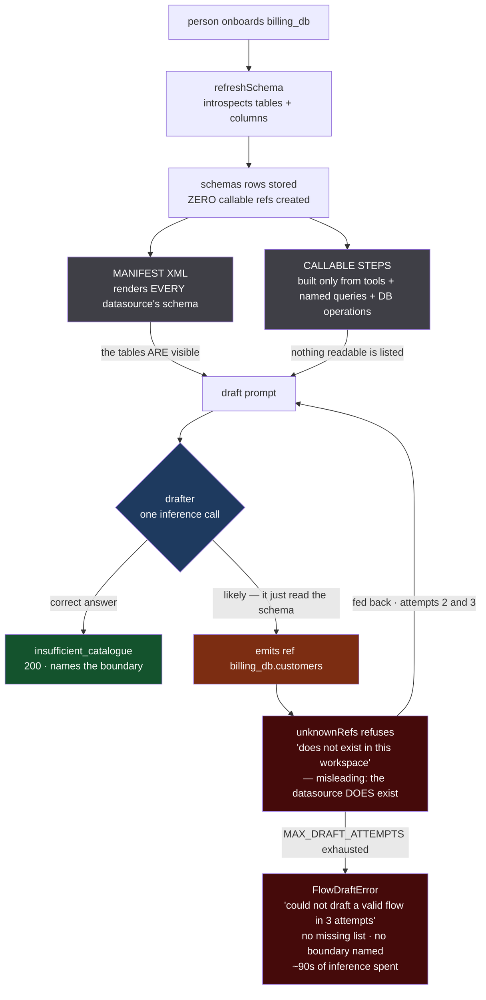
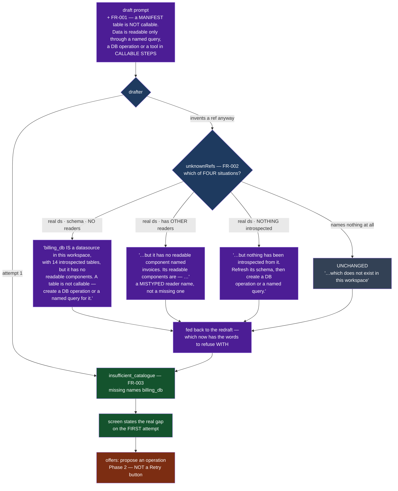
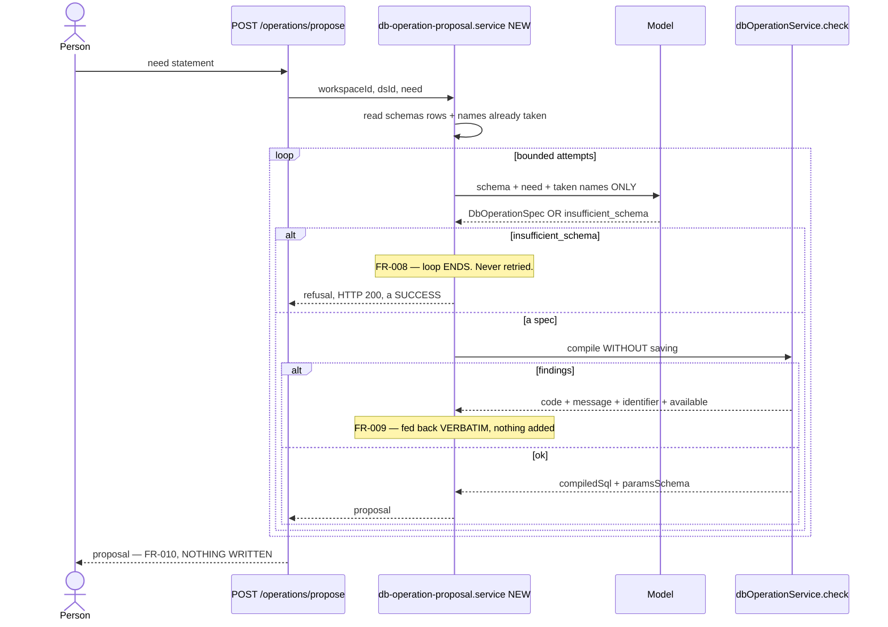
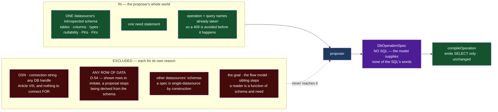
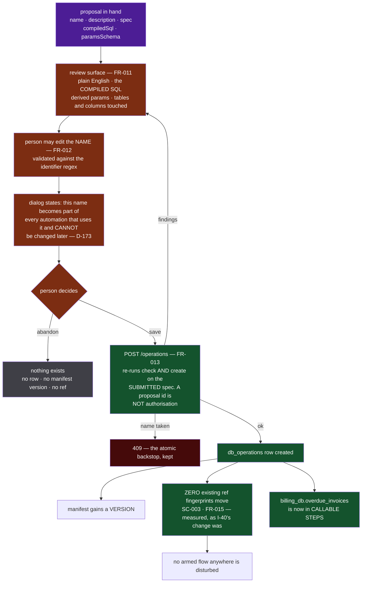
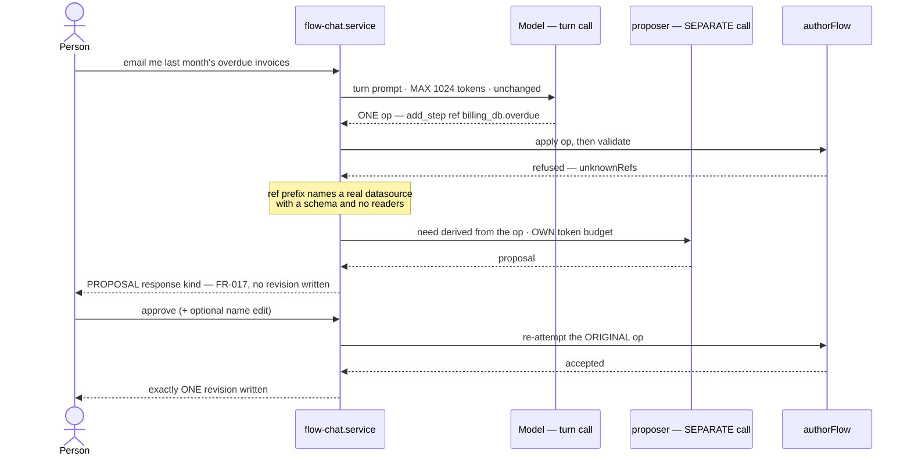
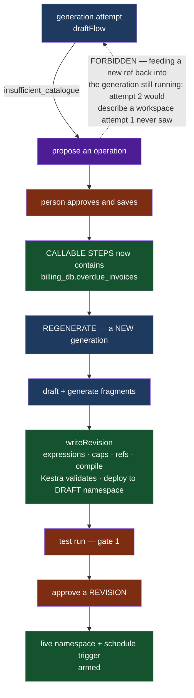
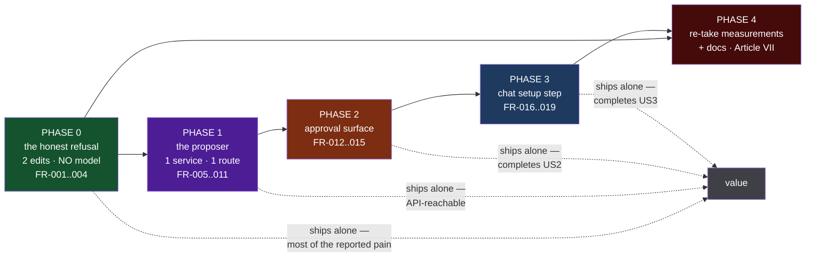

# Workflow diagrams

**Feature**: `20260827-053157-proposed-db-operations` · **Spec**: [spec.md](./spec.md) ·
**Plan**: [plan.md](./plan.md) · **Contract**: [contracts/operation-proposal.md](./contracts/operation-proposal.md)

Eight diagrams. Each shows one mechanism the plan argues about, and each is cross-referenced to the
`FR-nnn` / `D-nnn` it draws. Colour is never the only carrier — every node says what it is.

| Fill | Meaning |
| :--- | :--- |
| `#3f3f46` grey | exists today, unchanged by this feature |
| `#1e3a5f` blue | an inference call |
| `#14532d` green | deterministic code — the half that cannot be talked into anything |
| `#7c2d12` brown | a person |
| `#4c1d95` purple | new in this feature |
| `#450a0a` red | a dead end, or an answer nobody can act on |

---

## 1. Today — the dead end

The asymmetry inside a single draft prompt: the manifest shows the tables, CALLABLE STEPS says
*"anything not listed does not exist"*, and **nothing joins those two facts**. The right-hand path is the
likely one, and it ends somewhere nobody can act on.

---

## 2. Phase 0 — the honest refusal *(no model authors anything)*

Two edits close the dead end. **This ships alone** and is most of the reported pain.
`FR-001` is the prompt half of the I-118 pairing; `FR-002` is the check half, which already existed and
only needed to know more.

⚠ **`OFFER` is not a Retry.** It offers a *different action*, exactly as the `policy_transform` confirm
button does. The regenerate button's existing disabled-until-the-goal-changes rule is untouched.

⚠ **Four sentences, not two** (`D-181`, taken during P0 — this diagram showed one until then). `S2` and
`S3` are not decoration; **each one keeps `S1` honest**:

* without `S2`, a **mistyped reader name** on a datasource with three readers is told it has none — a
  fresh false sentence standing exactly where the old one stood, and worse, because a redraft can fix a
  wrong reader name and could never fix *"does not exist"*;
* without `S3`, a datasource whose schema refresh failed is sent to build an operation against a schema
  that is not there. That state is **common, not exotic**: `addDatasource` runs create → test →
  refreshSchema with the last two `.catch(() => null)`, so "onboarded with no schema" is a *successful*
  onboarding.

⚠ `S1`'s **14** is a count of **distinct entities**, never of `schemas` rows — one row per *column* would
report six tables where there are two (`D-182`).

---

## 3. Phase 1 — the proposal loop

The fragment generator's shape, one subject along: **two channels**, findings retried, refusal never
(`D-171`). The model fills in a form; `compileOperation` — deterministic, existing — is the only thing
that produces SQL.

| | Retried? | Why |
| :--- | :--- | :--- |
| `check()` finding — unknown column, invalid join | ✅ bounded | Mechanical. Names the identifier *and* what was available. |
| `insufficient_schema` | ❌ **never** | §6.7. Re-asking is how *"there is no due date"* becomes a plausible `created_at` on attempt 2. |

---

## 4. The isolation boundary — `FR-005`, asserted against the module's own source

Modelled on `buildFragmentPrompt`: **what it cannot see is the value.** `FR-006` asserts this by reading
the module's source, not its behaviour — because a behavioural test passes just as well when a field is
present and merely unused, and the next person to touch the function will use it.

Two properties survive **unchanged** (`D-169`):

1. **Identifiers are metadata, never input** — every table, column and join side resolves against the
   introspected rows, or is a structured finding naming what *was* available.
2. **Values are positional parameters** — a filter binds to `$n` in spec order; `params_schema` is
   *derived*. A parameter cannot become SQL.

---

## 5. Phase 2 — the write boundary

`D-170`. Nothing exists until a person saves, and **the save re-verifies the submitted spec** rather than
trusting that a proposal was approved — because the dialog is editable by design, so what arrives at save
is frequently not what was proposed.

⚠ **A proposal is never persisted "so the person can come back to it."** A stored proposal is a
half-created ref with a lifecycle, and the review it waits on is exactly what makes it safe.

---

## 6. Phase 3 — chat: a setup step that does not spend the op

`D-175`, and the subtlety is that the one-op bound is **not a prompt rule** — it is
`CHAT_TURN_MAX_TOKENS = 1024`, a hard output ceiling chosen so a flow does not fit. Widening the turn's
response to carry an op *and* a spec would raise that ceiling, which is how *"a turn cannot be a
redesign"* stops being structural.

So: **two calls with two budgets.** The turn stays one op.

Invariants a test holds (`SC-005`, `FR-016`, `FR-018`):

- a turn still carries **at most one op**
- `CHAT_TURN_MAX_TOKENS` is still **1024**
- the proposer imports **nothing** from `flow-generation.service.ts`
- `flow-chat-imports.test.ts` is **extended** to pin the chat service's import of the proposer — the
  existing test only reads symbols from `flow-generation.service.js` and would not have seen a new module

---

## 7. Where it sits in the whole lifecycle — `D-174`

⚠ **The catalogue changes BETWEEN generations, never inside one.** Proposing during `draftFlow`'s redraft
loop would mutate the catalogue while the loop runs, so attempt 2's prompt would describe a workspace
attempt 1 never saw — breaking *"a retry appends; it never rewrites"*, and breaking it invisibly, because
the model would simply return a different plausible answer.

Three user actions, deliberately: **refuse → approve → regenerate.** Not one button.

---

## 8. Phase dependency

Every phase ships value alone. Phase 4 is the exception that is **not optional** — Phase 0 moves
`DRAFT_RULES`, which is the cached prefix, so every draft measurement on record goes stale for this path
the moment it lands (`D-176`).

⚠ Until Phase 4 re-takes them, **no number from `kestra:refusal`, `outline:measure`, `draft:measure` or
`chat:measure` may be quoted for this path** — the same rule the 2026-08-21 chat prompt edits were left
under.

---

## What no diagram here can show

⚠ **A proposal can be valid SQL and semantically wrong** — wrong join direction, wrong filter operator, a
missing `COALESCE`. This is the units trap one subject along, and **nothing in this feature catches it**:
not `check()`, not `compileOperation`, not `checkSq⚠ A proposal can be valid SQL and semantically wrong — wrong join direction, wrong filter operator, a missing COALESCE. This is the units trap one subject along, and nothing in this feature catches it: not check(), not compileOperation, not checkSqlShape.

The person in diagram 5 is reviewing intent, and the compiled SQL is shown precisely so it can be reviewed. FR-021 forbids any surface calling an approved operation correct, and SC-006 requires a measured acceptance rate before anyone describes this as reliable.

⚠ And that measurement has a sharp edge worth stating beside the diagram it belongs to: a high unedited-acceptance rate is ambiguous — the proposals are good, or nobody is reading them, and the two are identical in the data.

at what step the sql is getting generated 
is it during data source onboarding where named queries approved by the user will be generated and stored or 
is it when user starts using the chat builder?
lShape`.

The person in diagram 5 is reviewing **intent**, and the compiled SQL is shown precisely so it can be
reviewed. `FR-021` forbids any surface calling an approved operation *correct*, and `SC-006` requires a
measured acceptance rate before anyone describes this as reliable.

⚠ And that measurement has a sharp edge worth stating beside the diagram it belongs to: a **high
unedited-acceptance rate is ambiguous** — the proposals are good, *or* nobody is reading them, and the two
are identical in the data.
