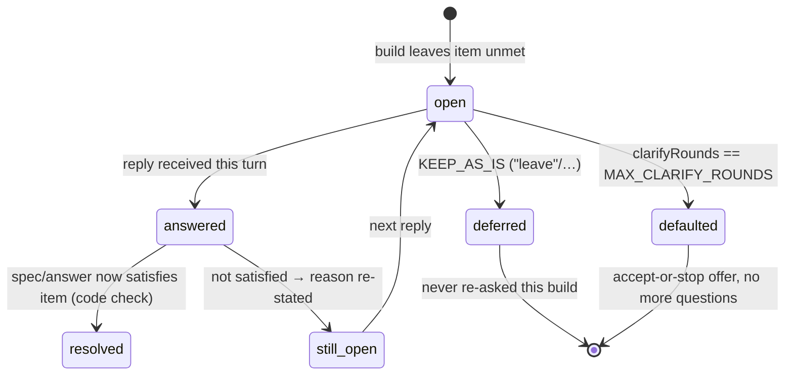

# Phase 1 Data Model: Conversation & Open Items

**Feature**: [spec.md](./spec.md) | **Decisions**: [research.md](./research.md)

## Conversation (persisted at `flow.build.goalSpec.conversation`)

Existing fields (unchanged): `goal`, `texts`, `spec`, `pending`, `current`,
`known`, `existing`, `local`, `corrected`, `unsettled`, `wasUnsettled`.

| Field | Change | Rules |
|-------|--------|-------|
| `answers: Record<string, string>` | **Semantics hardened** | Append-only per build. Key = stable question id (D2). No construction site may assign `answers: {}` when a previous map is non-empty. Read: latest write wins (correction supersedes). |
| `pending: string \| null` | unchanged | Question id awaiting a reply, or `clarify:unsettled`, or null. |
| `unsettled: string[]` | unchanged role | Open items from the last build; what a `CLARIFY` reply addresses. |
| `wasUnsettled: string[]` | unchanged | Prior round's list — drives the "did not settle" vs "not settled yet" wording. |
| `clarifyRounds: number` | **NEW** | Count of CLARIFY rounds entered. Incremented on each `continueBuild` with `clarifying === true`. At `MAX_CLARIFY_ROUNDS` (5) → terminal offer state. |
| `deferred: string[]` | **NEW** | Question ids the person deferred ("leave", "skip", …). A deferred id is never re-asked and never counts as unanswered for `needs_input`. |

### Stable question ids (D2)

| Question kind | Old id | New id |
|---|---|---|
| unclear words | `unclear:<i>:<about>` | `unclear:<norm(quote)>:<about>` |
| everything else (`spec:`, `cond:`, `shape:`, `delivery:`, `assumed:`, solver port holes) | unchanged | unchanged — already content/position-stable within a spec, and port hole ids are flow-derived |

`norm()` = the casefold/whitespace normalisation already used by
`quoted()`/`norm` in `goal-spec.ts` — one normalisation, reused, never a
second one (Constitution IV).

## Open item lifecycle (FR-004, FR-009)

An open item is a string in `unsettled` today; the states below are computed
by code at each turn boundary (no new persistence needed — derivable from
`answers` + `spec` + `unsettled`):



Transition rules:
1. `open → resolved` is decided by **code**: the item's requirement holds
   against the updated spec/answer set (e.g. the quoted words now appear in
   `texts` with a placed value; a named recipient now exists in the spec).
2. `answered → still_open` must carry a **specific reason** and must never be
   byte-identical to the previous round's item list without a state change
   (FR-009) — if nothing changed, the turn says which item blocked it.
3. `deferred` and `defaulted` are terminal for the build (FR-005/FR-006).

## Turn state transitions (builderAnswer path)

```
pending = clarify:unsettled
  ├─ KEEP_AS_IS matches ──► defer: pending=null, deferred+=…, no model call
  ├─ clarifyRounds == MAX ─► terminal offer (accept defaults | stop)
  └─ otherwise ────────────► continueBuild:
                              clarifyRounds++
                              answers  = {...prev.answers, [stableIds]: text}   ◄── D1/D3
                              understand(correction)                            (model)
                              step(replay with accumulated answers)             (code)
pending = other question id
  ├─ KEEP_AS_IS matches ──► defer that question (NEW: honored for any pending)
  └─ otherwise ───────────► answers[pending] = text → step(replay)
```

## Invariants (asserted by tests)

- **I1 (no wipe)**: for every turn, `keys(prev.answers) ⊆ keys(next.answers)`.
- **I2 (no re-ask)**: no question id in `deferred` or with a stored answer is
  ever emitted as the pending question again.
- **I3 (stable identity)**: re-deriving the spec from the same goal yields the
  same unclear hole ids regardless of list order/index.
- **I4 (bound)**: a conversation reaches `defaulted` after
  `MAX_CLARIFY_ROUNDS` clarification rounds; no question is asked after it.
- **I5 (monotonic)**: `unsettled` after a round ⊆ previous ∪ newly-introduced,
  with each removed item provably resolved and each retained item carrying a
  reason.
- **I6 (status truth)**: `asks`/`needs_input` iff ∃ an unanswered,
  non-deferred, non-bound question.
